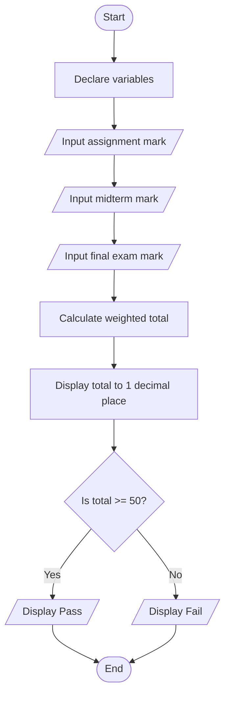
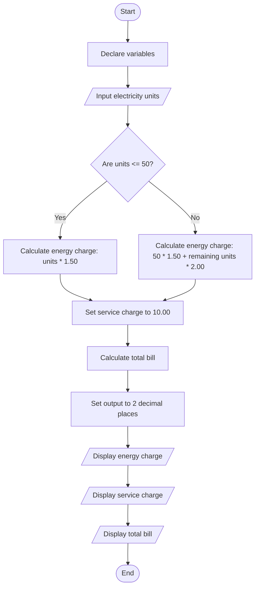
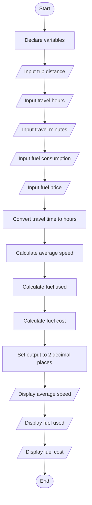

# Task 1: Student Course Total

**Source Code:** [Student Course Total.cpp](./Student_course_total.cpp)

## Flowchart

---

# Task 2: Electricity Bill

**Source Code:** [Electricity Bill.cpp](./Electricity_bill.cpp)

## Flowchart

---

# Task 3: Trip Speed and Fuel Cost

**Source Code:** [Trip Speed and Fuel Cost.cpp](./Trip_speed_and_fuel_cost.cpp)

## Flowchart

